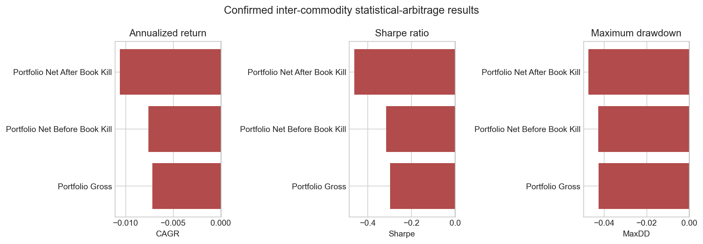

# Inter-Commodity Statistical Arbitrage

This project evaluates mean-reversion strategies between economically related futures markets. Its main contribution is a complete, auditable research funnel that starts with 1.46 GB of intraday data and ends with an honest negative out-of-sample result after trading costs.

The project treats failure to find a robust edge as a valid research outcome rather than hiding unsuccessful pairs or reporting only the best in-sample result.

## Project objective

The research asks whether economically related futures pairs exhibit a stable long-run relationship that can support a cost-aware, risk-controlled statistical-arbitrage portfolio.

The pipeline:

1. constructs daily continuous indices from five-minute contract data;
2. forms candidate pairs inside predefined economic groups;
3. filters pairs using return correlation, cointegration, residual stationarity, and half-life;
4. estimates a hedge ratio using only the current training window;
5. generates a robust normalized spread signal;
6. applies hysteresis, stop boundaries, and maximum holding periods;
7. evaluates the signal in a rolling out-of-sample test with a one-day execution lag;
8. subtracts two-leg turnover costs and applies portfolio risk controls.

## Data

The original source is a 1.46 GB dictionary of 35 five-minute futures tables. Raw data are not included. The confirmed research panel contains:

| Item | Value |
|---|---:|
| Instruments used | 18 |
| Daily observations | 1,558 |
| Research period | Jan 3, 2010-Jan 1, 2015 |
| Economically related candidate pairs | 42 |
| Pair-by-refit procedures | 840 |
| Out-of-sample return matrix | 778 x 14 |

Continuous daily indices are built from active contracts. Returns on roll days are set to zero in the saved implementation; real roll execution costs are not modeled separately.

## Methods

- Economic grouping before statistical testing.
- Hedge-ratio estimation without an intercept.
- Engle-Granger-style cointegration checks and ADF residual-stationarity tests.
- Mean-reversion half-life estimation.
- Rolling median and robust scale normalization.
- Empirical entry/exit hysteresis, stop levels, and maximum holding duration.
- One-day signal lag to prevent same-close execution assumptions.
- One-basis-point cost applied to changes in each leg.
- Volatility targeting, pair and group caps, and a portfolio circuit breaker.
- Rolling refits with explicit recording of every filter failure.

## Confirmed results

Only 21 of 840 pair-by-refit cases passed every filter, a pass rate of 2.50%. Fourteen unique pairs passed at least once, and the portfolio held only 0.4 active strategies per day on average.

| Portfolio version | Annualized return | Annualized volatility | Sharpe ratio | Max drawdown |
|---|---:|---:|---:|---:|
| Gross | -0.72% | 2.34% | -0.298 | -4.26% |
| Net before circuit breaker | -0.76% | 2.34% | -0.315 | -4.28% |
| Net after circuit breaker | -1.06% | 2.25% | -0.462 | -4.74% |

The tested specification did not retain a robust edge after costs. The circuit breaker also made the result worse because its data-coverage rule sometimes interpreted holidays and calendar differences as data failures.



## Repository structure

```text
main/
  HW_6.ipynb                        full executed notebook with embedded outputs
  requirements.txt                  notebook dependencies
  results/
    confirmed_run_metadata.json
    filter_diagnostics.csv
    filter_failure_reasons.csv
    pair_oos_metrics.csv
    portfolio_summary.csv
    selected_pairs_by_refit.csv
    stat_arb_summary.png
```

## Reproduction

```bash
python -m pip install -r main/requirements.txt
```

Place the raw futures dictionary at `data/dfs_5min.pickle`, update `DATA_PATH` in `main/HW_6.ipynb`, and run the cells in order. The executed notebook already contains the saved charts and tables, so the confirmed result can be reviewed without the raw dataset.

## Limitations

- The strategy is evaluated on daily closes rather than executable bid and ask quotes.
- Roll-day returns are neutralized and real roll costs are not modeled separately.
- Costs use a simplified one-basis-point rule for each leg change.
- Multiple-testing correction across 42 pairs and repeated windows is not applied.
- Risk groups are defined economically rather than learned statistically.
- Positive pair-level metrics may be based on very few active days.

This repository is a research record, not investment advice or a production statistical-arbitrage system.
